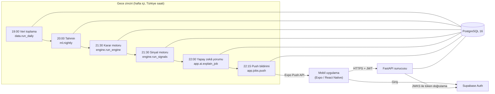
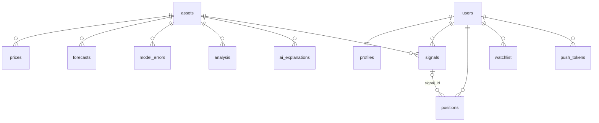

# Sistem Mimarisi, Karar Motoru, Sinyal Motoru ve Veritabanı

*Yazan: Kişi 2 (Zahide Torun). Tez birleştirmesi için taslak; şekil ve tablo numaraları birleştirmede verilecektir.*

> Not: Köşeli parantez içindeki **[ölçülecek]** işaretli değerler, sunucu yayına alındıktan sonra gerçek ölçümle doldurulacaktır.

---

## 1. Sistem Mimarisi

### 1.1 Tasarım ilkeleri

Sistemin mimarisi dört ilkeye dayanır:

1. **Toplu (batch) hesaplama, anlık okuma.** Zaman serisi temel modelleri (TimesFM, Chronos) telefonda çalıştırılamayacak kadar ağırdır. Bu yüzden tüm tahmin ve karar hesapları her iş günü akşamı sunucuda bir kez yapılır; mobil uygulama yalnızca hazır sonuçları okur. Böylece kullanıcının gördüğü her ekran tek bir veritabanı sorgusuyla, milisaniyeler içinde yanıtlanabilir.
2. **Sözleşme önce gelir.** Üç ekip üyesinin paralel çalışabilmesi için veritabanı şeması (`shared/db_schema.sql`) ve REST API sözleşmesi (`shared/openapi.yaml`) ilk iki haftada birlikte yazılıp donduruldu. Sözleşmede yapılacak her değişiklik ekipçe onaylanan bir birleştirme isteği (pull request) gerektirir.
3. **Her tablonun tek bir yazanı vardır.** Örneğin `prices` ve `forecasts` tablolarını yalnızca veri/model katmanı, `analysis` ve `signals` tablolarını yalnızca karar motoru, `ai_explanations` tablosunu yalnızca yapay zekâ katmanı yazar. Bu kural hem hata ayıklamayı kolaylaştırır hem de ekip üyeleri arasında yazma çakışmasını önler.
4. **Yatırım tavsiyesi verilmez.** Sermaye Piyasası Kurulu (SPK) düzenlemeleri gereği sistem hiçbir yerde "al" ya da "sat" demez. Üretilen çıktı bir **model sinyalidir**; arayüzde "yükseliş yönlü model sinyali" ve "satış yönlü model sinyali" ifadeleri kullanılır, bildirimler dahil her ekranda "Yatırım tavsiyesi değildir" uyarısı yer alır.

### 1.2 Bileşenler

*Şekil X. Sistemin bileşenleri ve gece veri akışı.*

| Bileşen | Teknoloji | Görev |
|---|---|---|
| Veritabanı | PostgreSQL 16 | Tüm kalıcı veri; şema Alembic göçleriyle yönetilir |
| API sunucusu | FastAPI, SQLAlchemy 2, Pydantic 2 | Mobilin konuştuğu REST uç noktaları |
| Kimlik doğrulama | Supabase Auth (ES256, JWKS) | Kullanıcı girişi; sunucu yalnızca token doğrular |
| Karar motoru | Python, pandas | Tahminleri yön, güven ve risk değerlendirmesine çevirir |
| Sinyal motoru | Python | Kullanıcıya özel model sinyalleri üretir |
| Gece zamanlayıcısı | APScheduler + alt süreçler | Zinciri sırayla, bağımlılıklarına bakarak çalıştırır |
| Bildirim | Expo Push API | Model sinyallerini telefona iletir |
| Geliştirme ortamı | Docker Compose, GitHub Actions | Tek komutla çalışan ortam; her PR'da otomatik test |

### 1.3 API sunucusu

API, `shared/openapi.yaml` sözleşmesindeki uç noktaları gerçekler:

- **Piyasa verisi:** `/assets` (arama ve tür süzgeciyle varlık listesi), `/assets/{code}/history`, `/assets/{code}/forecast`, `/assets/{code}/analysis` ve `/screener`.
- **Kullanıcı verisi:** `/me/profile`, `/portfolio`, `/watchlist`, `/devices/push-token`.
- **Sinyaller:** `/signals` ve sinyal sicili `/signals/track-record`.
- **Model başarımı:** `/backtest/summary`.

**Kimlik doğrulama.** Kullanıcı girişi Supabase üzerinde yapılır; sunucu parola görmez. Mobil uygulama her isteğe Supabase'in verdiği erişim token'ını (JWT) ekler. Sunucu bu token'ı Supabase'in yayımladığı açık anahtarlarla (JWKS, ES256) doğrular; eski projelerle uyum için HS256 gizli anahtarı da desteklenir. İlk istekte kullanıcı ve varsayılan profil kaydı (`users`, `profiles`) otomatik oluşturulur.

**Yetkilendirme.** Kullanıcıya ait her sorgu `user_id` ile süzülür. Başka bir kullanıcının kaydına yapılan erişim "bulunamadı" (404) olarak yanıtlanır; böylece kaydın var olup olmadığı bile sızdırılmaz. Bu kural her uç nokta için ayrı otomatik testlerle denetlenir.

**Sahte veri (mock) modu.** `MOCK=1` ortam değişkeniyle sunucu, henüz yazılmamış ya da veritabanı boş olan uç noktalara sözleşmedeki örneklerle yanıt verir. Mobil uygulama bu sayede sunucu tamamlanmadan geliştirilebildi. Sahte yanıtlar isteğe göre uyarlanır: istenen varlık kodu yanıta yerleştirilir, arama ve tür süzgeci uygulanır. Yanıtlar `X-Mock: 1` başlığıyla işaretlenir.

**İstek sınırı.** Her kullanıcı genel uç noktalara dakikada en fazla 120, büyük dil modeli çağıran `/ai/*` uç noktalarına ise dakikada en fazla 10 istek gönderebilir. Sınır kayan pencere (sliding window) yöntemiyle uygulanır. Aşıldığında sunucu `429 Too Many Requests` yanıtı ve `Retry-After` başlığı döner.

**Performans.** Varlık listesi her varlık için yalnızca son iki fiyat satırını birincil anahtar indeksi üzerinden okur; yaklaşık bir milyon satırlık fiyat tablosu taranmaz. Veri günde bir kez değiştiği için aramasız liste 60 saniye bellekte tutulur. Türkçe arama için `İ/I/ı/i` harfleri eşdeğer sayılır ("iş", "İŞ" ve "IS" aynı sonucu verir).

| Uç nokta | Ortalama yanıt süresi | 95. yüzdelik |
|---|---|---|
| `GET /assets` | [ölçülecek] | [ölçülecek] |
| `GET /assets/{code}/analysis` | [ölçülecek] | [ölçülecek] |
| `GET /portfolio` | [ölçülecek] | [ölçülecek] |
| `GET /signals` | [ölçülecek] | [ölçülecek] |

*Tablo X. API yanıt süreleri.*

### 1.4 Gece zinciri

Gece işleri her hafta içi akşamı sırayla çalışır (Şekil X). Zamanlayıcı her adımı ayrı bir işletim sistemi süreci olarak başlatır; bu sayede bir adımın çökmesi zamanlayıcıyı durdurmaz. Kurallar şunlardır:

- **Bağımlılık:** Zorunlu bir adım başarısız olursa sonraki adımlar çalıştırılmaz. Atlanan her adım, nedeniyle birlikte (ör. "atlandı: önceki adım (forecast) başarısız") `job_runs` tablosuna yazılır. İzleme yapılırken zincirin nerede koptuğu bu sayede doğrudan görülür.
- **Kaldığı yerden devam:** O gün başarıyla tamamlanmış adım tekrar çalıştırılmaz. Sorun giderildikten sonra zincir yeniden başlatıldığında yalnızca eksik adımlar çalışır.
- **Takvim:** Hafta sonları ve Borsa İstanbul'un tam gün kapalı olduğu resmî tatillerde zincir çalışmaz.
- **Zaman aşımı:** Her adımın bir üst süre sınırı vardır; sınırı aşan adım başarısız sayılır.
- **Ertelenmiş bildirim:** Sessiz saat ayarı nedeniyle gece gönderilemeyen bildirimler her sabah 08:05'te gönderilir.

### 1.5 Geliştirme ve test altyapısı

Tüm ortam `docker compose up` komutuyla ayağa kalkar: veritabanı başlatılır, Alembic göçleri uygulanır ve API sunucusu çalışır. Her birleştirme isteğinde GitHub Actions üç işi koşturur:

1. Arka uç: ruff ile kod biçimi ve kalite denetimi, ardından gerçek bir PostgreSQL servisine karşı pytest.
2. Veri ve model testleri.
3. Mobil uygulamanın TypeScript tip denetimi.

`main` dalı korumalıdır: testler geçmeden ve bir ekip üyesinin onayı olmadan birleştirme yapılamaz.

Veritabanı testleri sahte nesne kullanmaz; gerçek PostgreSQL üzerinde, sözleşmedeki şemanın göçlerle birebir aynı olduğunu (sütunlar ve kısıtlar dahil) doğrulayan bir sözleşme testi de bulunur. Karar motoru ve sinyal motoru, gerçek veritabanında uçtan uca testlerle sınanır: veri yüklenir, motor çalıştırılır, API'nin motorun yazdığı sonucu döndürdüğü doğrulanır.

---

## 2. Karar Motoru

Karar motoru projenin özgün algoritmik katkısıdır. Girdisi, her varlık için o gece üretilmiş model tahminleri (her model için 10., 50. ve 90. yüzdelik değerleri), modellerin geçmiş hata ölçüleri ve fiyat geçmişidir. Çıktısı, her varlık ve her kısa ufuk (1, 5 ve 20 iş günü) için `analysis` tablosuna yazılan bir satırdır: yön (yükseliş, düşüş, yatay), 0–100 arası güven skoru, risk seviyesi, piyasa rejimi, model ağırlıkları, gösterge değerleri ve tahmin bandı.

Motor saf hesap modülleri (`engine/indicators.py`, `ensemble.py`, `regime.py`, `decision.py`) ile veritabanı işini yapan `run_engine.py` olarak ikiye ayrılmıştır. Bu ayrım, algoritmanın veritabanı olmadan birim testleriyle sınanmasını ve aynı kodun backtest yeniden oynatmasında (Bölüm X, Kişi 1) değiştirilmeden kullanılmasını sağlar.

### 2.1 Teknik göstergeler

Fiyat serisi olarak düzeltilmiş kapanış (temettü ve bölünme etkisi arındırılmış) kullanılır. Hesaplanan göstergeler:

| Gösterge | Tanım |
|---|---|
| RSI(14) | Wilder yumuşatmasıyla göreli güç endeksi |
| MACD(12, 26, 9) | Hızlı ve yavaş üssel ortalamaların farkı, sinyal çizgisi ve histogram |
| MA20, MA50 | 20 ve 50 günlük basit hareketli ortalamalar ve birbirine göre konumları |
| ATR(14) | Ortalama gerçek aralık; yüksek/düşük değerler düzeltilmiş kapanış oranıyla ölçeklenir |
| vol20 | 20 günlük getirilerin yıllıklandırılmış standart sapması (%) |

Yatırım fonlarında yalnızca günlük fiyat bulunduğundan (açılış, en yüksek ve en düşük yok) MACD ve gerçek ATR hesaplanmaz; ATR yerine günlük volatiliteden türetilen bir eşdeğer kullanılır.

**Sızıntı önleme.** Her gösterge yalnızca o güne kadarki veriyle hesaplanır. Bir "kesme testi" bunu denetler: seri herhangi bir günde kesildiğinde o güne ait gösterge değeri değişmemelidir. Uçtan uca testte gelecek tarihli, gerçek dışı (on kat) bir fiyat veritabanına eklenir ve motorun bunu görmediği doğrulanır.

### 2.2 Model birleştirme (ensemble)

Kullanılan modeller TimesFM, Chronos ve bir baseline olan sürüklenmeli naif modeldir (naive drift). Baseline'ın bilinçli olarak dahil edilmesinin nedeni, Kişi 1'in backtest'inde fonlarda en güçlü modellerden biri çıkmasıdır.

Her modelin ağırlığı, o varlık ve ufuk için son 60 iş günündeki ortalama mutlak hatasının (MAE) tersiyle orantılıdır:

$$ w_m = \frac{1/\mathrm{MAE}_m}{\sum_k 1/\mathrm{MAE}_k} $$

Ağırlıklar için alt sınır 0,1'dir. Hiçbir model sıfır ağırlık almaz; böylece kısa bir dönem iyi giden tek bir modele aşırı güvenilmez. Hata kaydı olmayan modele diğerlerinin ortalama ağırlığı verilir; hiç hata kaydı yoksa ağırlıklar eşittir. Birleşik tahmin bandı, yüzdeliklerin ağırlıklı ortalamasıdır:

$$ \hat{p}_{q} = \sum_m w_m \, p_{q,m}, \qquad q \in \{10, 50, 90\} $$

Hata kayıtları yalnızca analiz gününe kadar olanlardan seçilir; analiz gününden sonra hesaplanmış bir hata kaydı kullanılmaz (sızıntı önleme).

### 2.3 Piyasa rejimi

Her varlık için üç rejimden biri belirlenir:

- **Yüksek oynaklık (high_vol):** Bugünkü vol20, varlığın son bir yıllık vol20 dağılımının 80. yüzdeliğinin üstündeyse **ve** yıllık medyanın en az 1,2 katıysa. İkinci koşul, oynaklığı yıl boyunca sabit olan bir seride rastgele dalgalanmaların yanlışlıkla "yüksek oynaklık" sayılmasını önler.
- **Trend:** Hisselerde ADX(14) > 25. Fonlarda ADX hesaplanamadığı için Kaufman verimlilik oranı ER(20) > 0,30 kullanılır. ER, net fiyat değişiminin günlük değişimlerin mutlak toplamına oranıdır: 1 dümdüz bir trendi, 0 yerinde saymayı gösterir.
- **Yatay (range):** Diğer durumlar.

Ayrıca BIST 100 endeksi (XU100) için aynı sınıflandırma yapılır ve her satıra genel piyasa rejimi olarak eklenir.

### 2.4 Yön

Ensemble'ın medyan tahmini ile son fiyat arasındaki fark, varlığın oynaklığına göre ölçeklenmiş bir eşikle karşılaştırılır:

$$ \Delta = \hat{p}_{50} - P_t, \qquad \tau_h = 0{,}5 \cdot \mathrm{ATR} \cdot \sqrt{h} $$

$\Delta > \tau_h$ ise yön yükseliş, $\Delta < -\tau_h$ ise düşüş, aksi hâlde yataydır. $\sqrt{h}$ çarpanı, rastgele yürüyüşte beklenen fiyat hareketinin ufkun kareköküyle büyümesinden gelir. Böylece 20 günlük ufukta küçük bir beklenen değişim yön sinyali sayılmaz.

### 2.5 Güven skoru

Güven skoru, şeffaflık için toplamsal ve bileşenlerine ayrılabilir biçimde tasarlandı:

$$ G = \mathrm{temel} + 40 \cdot \mathrm{güç} + 30 \cdot \mathrm{uyum} - \mathrm{cezalar}, \qquad G \in [0, 100] $$

- **Temel puan:** 30.
- **Sinyal gücü** (0–1): $|\Delta|$'nın tahmin bandının yarı genişliğine oranı, $\min\left(1, |\Delta| / ((\hat{p}_{90} - \hat{p}_{10})/2)\right)$. Beklenen değişim belirsizliğe göre büyükse güç yüksektir.
- **Model uyumu** (0–1): Ensemble'ın yönünü gösteren modellerin toplam ağırlığı.
- **Cezalar:**

| Durum | Ceza |
|---|---|
| Göstergeler yönle çelişiyor (ör. yükseliş yönünde RSI ≥ 70; MA20 MA50'nin altında ve MACD histogramı negatif). Her çelişki için, en fazla iki | 10 |
| Düşük likidite: son 20 günün ortalama işlem hacmi 5 milyon TL'nin altında (yalnızca hisse) | 15 |
| Kısa geçmiş: 250 iş gününden az veri | 10 |
| Yüksek oynaklık rejimi | 10 |

**Yatay yön.** Yatay kararı "beklenen bir hareket yok" anlamına gelir ve sinyal üretmez. İlk sürümde yatay kararlar için sinyal gücü "değişim eşikten ne kadar küçükse o kadar güçlü", uyum ise "model bandı son fiyatı içeriyor mu" olarak tanımlanmıştı. Kişi 1'in kalibrasyon çalışması (Bölüm 2.7) bu tanımın kusurlu olduğunu gösterdi: geniş bantlar son fiyatı neredeyse her zaman içerdiğinden yatay kararlar yapısal olarak 90'ın üzerinde güven alıyordu. Hisselerin %99'u yatay olduğu hâlde ortalama güven 87–89 çıkıyordu. Düzeltilmiş sürümde:

- yatay kararlarda güç puanı verilmez,
- uyum, medyan tahmini eşik içinde kalan modellerin ağırlık payıdır,
- skor en fazla 50'dir (ya da kalibrasyonun önerdiği daha düşük tavan).

Skorun tüm bileşenleri `analysis.indicators.confidence_parts` alanına yazılır. Böylece "bu sinyal neden bu güveni aldı?" sorusu kullanıcıya ve yapay zekâ yorum katmanına bileşen bileşen açıklanabilir.

### 2.6 Risk seviyesi

Risk, varlığın kendi yıllık oynaklığına (vol20) göre üç seviyede belirlenir. Hisseler ve fonlar çok farklı oynaklık düzeylerinde olduğundan eşikler türe göre ayrıdır:

| Tür | Düşük | Orta | Yüksek |
|---|---|---|---|
| Hisse | < %35 | %35–55 | ≥ %55 |
| Fon | < %10 | %10–25 | ≥ %25 |
| Endeks | < %20 | %20–35 | ≥ %35 |

Yüksek oynaklık rejimindeki bir varlığın riski bir kademe artırılır. İlk sürümde tek bir eşik çifti (%25 / %45) kullanılıyor ve yüksek oynaklık rejimi riski doğrudan "yüksek" yapıyordu. Gerçek veride bu, hisselerin %75'inin yüksek riskli görünmesine yol açtı; Borsa İstanbul hisselerinin tipik yıllık oynaklığı zaten %30'un üzerindedir. Eşikler, Kişi 1'in vol20 dağılımıyla yeniden ayarlanacaktır.

### 2.7 Güven kalibrasyonu

Ham güven skoru bir olasılık değildir. Kişi 1, karar motorunu geçmiş tahmin günlerinde yeniden çalıştırarak yaklaşık 107 bin varlık-gün-ufuk örneği üzerinde güven ile isabet arasındaki ilişkiyi ölçtü. Bulgular:

- **Hisselerde** güven skoru isabeti ayırt etmiyor (Spearman ≈ 0).
- **Fonlarda yükseliş yönünde, 5 ve 20 günlük ufuklarda** güven arttıkça isabet artıyor (20 günde %81'den %99'a).
- **Fonlarda 1 günlük ufukta ve yatay kararlarda** ilişki ters yönde.

Bu sonuçla, her (varlık türü, ufuk, yön) için puan kovalarını geçmiş isabet oranına eşleyen izotonik bir eşleme kuruldu (Kişi 1). Karar motoru bu eşlemeyi şöyle kullanır (`engine/calibration.py`):

1. **Gösterim.** Eşlemenin güveni anlamlı kıldığı anahtarlarda kullanıcıya ham puan yerine geçmiş isabet gösterilir: "Geçmişte benzer model sinyallerinde isabet oranı %X (kıyas: %Y)". Kıyas oranı, güvene bakmadan aynı tür, ufuk ve yöndeki isabettir. Güvenin ayırt edici olmadığı anahtarlarda oran gösterilmez; kullanıcıya bunun açıkça söylenmesi, yanıltıcı bir yüzde göstermekten daha dürüsttür.
2. **Yatay tavanı.** Yatay kararların güveni, eşlemenin önerdiği tavanla sınırlanır.
3. **Sinyal kapısı.** Model kaynaklı sinyal yalnızca güvenin isabeti ayırt ettiği anahtarlarda üretilir (Bölüm 3).

Backtest yeniden oynatması kalibrasyonsuz (ham puanla) çalışır; aksi hâlde eşleme kendi çıktısıyla ölçülmüş olurdu.

### 2.8 Gerçek veriyle ilk çalıştırma

Karar motoru Kişi 1'in gerçek verisiyle uçtan uca çalıştırıldı: 774 varlık için 2.322 analiz satırı (774 × 3 ufuk) üretildi, hiçbir varlıkta hata oluşmadı ve iş `job_runs` tablosuna başarılı olarak kaydedildi. Bu çalıştırma, Bölüm 2.5 ve 2.6'da anlatılan iki düzeltmenin de çıkış noktası oldu.

---

## 3. Sinyal Motoru

Karar motoru varlık başına ve kullanıcıdan bağımsız çalışır. Sinyal motoru (`engine/signals.py`, `engine/run_signals.py`) ise bu analizleri her kullanıcının risk profili, bütçesi, izleme listesi ve portföyüyle birleştirerek kullanıcıya özel model sinyalleri üretir.

### 3.1 Yükseliş yönlü (alım yönlü) model sinyali

**Aday varlıklar:**
- kullanıcının izleme listesindeki varlıklar,
- izlenmeyen varlıklardan en güçlü 3 tanesi. Bunlar için eşik 10 puan daha yüksektir; kullanıcının ilgilenmediği bir varlık için daha güçlü kanıt aranır.

**Bir aday için tüm koşullar sağlanmalıdır:**
- yön yükseliş;
- güven, profil eşiğinin üstünde (temkinli 75, dengeli 65, atak 55);
- risk seviyesi profilin kabul ettikleri arasında (temkinli ve dengeli için düşük/orta, atak için tümü);
- kullanıcının bu varlıkta açık pozisyonu yok;
- son 5 gün içinde aynı varlık ve yön için sinyal üretilmemiş (bekleme süresi);
- kalibrasyon eşlemesi varsa, ilgili (tür, ufuk, yön) anahtarında güven ayırt edici.

Koşulları sağlayan ufuklar arasından güveni en yüksek olan seçilir; varlık başına tek sinyal üretilir.

**Önerilen miktar.** Bütçenin profil oranı (%5 / %10 / %15) son fiyata bölünür ve aşağı yuvarlanır.

**Zarar-durdur seviyesi.** Fiyat − 2 × ATR.

### 3.2 Satış yönlü model sinyali

Kullanıcının açık pozisyonları için üç durumda satış yönlü sinyal üretilir. Önem sırasıyla:

1. **Zarar-durdur:** Son fiyat, pozisyonun zarar-durdur seviyesinin altına inmiştir. Bu seviye pozisyon bir sinyalden açıldıysa o sinyalinkidir, değilse alış fiyatı − 2 × ATR.
2. **Model:** Yön düşüş ve güven profil eşiğinin üstünde.
3. **Hedef:** Son fiyat, 5 günlük tahmin bandının üst sınırını (90. yüzdelik) aşmıştır.

Önerilen miktar pozisyonun tamamıdır.

### 3.3 Sonuçların izlenmesi ve sinyal sicili

Her sinyalin ufku dolduğunda sonucu otomatik değerlendirilir. Gerçekleşen fiyat, sinyal gününden itibaren *h*'inci işlem gününün kapanışıdır. Yükseliş yönlü sinyal, gerçekleşen fiyat giriş fiyatının üstündeyse; satış yönlü sinyal ise altındaysa isabetli sayılır. Sonuç `signals.outcome` alanına giriş fiyatı, gerçekleşen fiyat, getiri ve değerlendirme günüyle birlikte yazılır.

`/signals/track-record` uç noktası bu sonuçlardan iki sicil üretir:

- **Kullanıcının sicili:** kendi sinyallerinin isabeti.
- **Modelin sicili:** tüm kullanıcılar. Aynı gece aynı varlık için birçok kullanıcıya giden özdeş sinyal bir kez sayılır.

İkisi de yön ve ufuk kırılımlarıyla verilir. Ortalama getiri sinyal yönünde ölçülür: satış yönlü bir sinyalden sonra fiyat düştüyse bu pozitif sayılır. Sicil, modelin geçmiş başarısını kullanıcıdan saklamadan gösterme ilkesinin parçasıdır.

### 3.4 Push bildirimleri

Bildirimler Expo Push API ile gönderilir. Tasarımda gözetilen kurallar:

- **Tekil bildirim:** Her sinyal en fazla bir kez bildirilir. Sözleşmeyi değiştirmemek için `signals` tablosuna "bildirildi" sütunu eklenmedi; gönderilen sinyal kimlikleri `job_runs` kaydında tutulur ve sonraki çalıştırmalar bunları atlar.
- **Sessiz saat:** Kullanıcının sessiz saat aralığındaki bildirimler sabaha ertelenir. 14 saatten eski sinyaller artık bildirilmez.
- **Gecelik sınır:** Kullanıcı başına gecelik bildirim sayısı sınırlıdır (varsayılan 5). Önce satış yönlü sinyaller, sonra güveni yüksek olanlar gönderilir.
- **Geçersiz cihazlar:** Expo, uygulaması silinmiş bir cihaz için "DeviceNotRegistered" döndürdüğünde ilgili token silinir. Bu hem gönderim yanıtında (ticket) hem de 15 dakika sonra sorgulanan teslim yanıtında (receipt) denetlenir.
- **Metin:** Bildirim metni tavsiye dili içermez, örneğin: "THYAO · 5 günlük ufukta yükseliş yönlü model sinyali · güven 72 — Yatırım tavsiyesi değildir."

---

## 4. Veritabanı

### 4.1 Şema

Veritabanı 14 tablodan oluşur. Tablolar, tek yazan ilkesine göre üç gruba ayrılır:

| Grup | Tablo | İçerik | Birincil anahtar |
|---|---|---|---|
| Veri / model (Kişi 1) | `assets` | Hisse, fon ve endeks tanımları | `code` |
| | `prices` | Günlük fiyatlar (fonda yalnızca kapanış) | `(code, date)` |
| | `forecasts` | Model tahminleri, yüzdelikler | `(code, run_date, model, horizon)` |
| | `scenarios` | 30 ve 120 günlük kötümser/temel/iyimser senaryolar | `(code, run_date, horizon)` |
| | `model_errors` | Model başarımı (MAE, MAPE, yön isabeti) | `(code, model, horizon, window_days, as_of)` |
| Karar ve kullanıcı (Kişi 2) | `analysis` | Karar motoru çıktısı | `(code, run_date, horizon)` |
| | `signals` | Kullanıcıya özel model sinyalleri ve sonuçları | `id` |
| | `users`, `profiles` | Kullanıcı ve risk profili, bütçe, bildirim ayarları | `id` / `user_id` |
| | `positions` | Kullanıcının kaydettiği alış ve satışlar | `id` |
| | `watchlist` | İzleme listesi | `(user_id, code)` |
| | `push_tokens` | Cihaz bildirim token'ları | `(user_id, token)` |
| | `job_runs` | Gece işlerinin çalışma kaydı | `id` |
| Yapay zekâ (Kişi 3) | `ai_explanations` | Analiz için doğal dil yorumu | `(code, run_date, horizon)` |

*Tablo X. Veritabanı tabloları.*

*Şekil X. Varlık-ilişki diyagramı (sadeleştirilmiş).*

### 4.2 Tasarım kararları

- **Doğal birincil anahtarlar.** Piyasa tablolarında birincil anahtar (varlık kodu, tarih, …) olarak seçildi. En sık sorgu olan "bir varlığın son N günü" böylece doğrudan birincil anahtar indeksiyle yanıtlanır. Gece işlerinin tekrar çalıştırılması da `INSERT … ON CONFLICT DO UPDATE` ile güvenlidir: aynı gece iki kez çalışan motor çift kayıt üretmez.
- **Kısıtlar veritabanında.** Yön, risk, profil, ufuk ve platform gibi alanların geçerli değerleri `CHECK` kısıtlarıyla tanımlıdır. Uygulama katmanında bir hata olsa bile geçersiz veri yazılamaz. Örneğin sinyal ufku 1, 5, 20 ve 30 ile sınırlıdır; 120 günlük ufuk sinyal üretmez.
- **Esnek alanlar JSONB.** Model ağırlıkları, gösterge değerleri, güven bileşenleri, sinyal sonuçları ve iş istatistikleri JSONB sütunlarda tutulur. Bu alanların içeriği proje boyunca genişledi (ör. kalibrasyon bilgisi eklendi), ancak şema değişikliği gerekmedi. "Neden bu sinyal?" açıklaması için gereken bilgiler ilk günden itibaren kaydedildi.
- **Kullanıcı verisinin silinmesi.** Kullanıcıya ait tüm tablolar `ON DELETE CASCADE` ile `users` tablosuna bağlıdır; hesap silindiğinde kişisel veri tek işlemle temizlenir.
- **Göçler.** Şema Alembic göçleriyle yönetilir. İlk göç sözleşme dosyasındaki SQL'i birebir çalıştırır. Sonraki değişiklikler (ör. endeks türünün eklenmesi) ayrı göçlerle yapılır. Bir sözleşme testi, göçlerle oluşan şemanın sözleşmedeki sütun ve kısıtlarla aynı olduğunu her PR'da doğrular.

### 4.3 İzlenebilirlik

`job_runs` tablosu her gece işinin başlangıç ve bitiş zamanını, durumunu (çalışıyor, başarılı, başarısız), hata metnini ve iş istatistiklerini tutar. İstatistikler arasında örneğin şunlar bulunur: karar motorunda işlenen ve atlanan varlık sayıları ile yön dağılımı; sinyal motorunda üretilen sinyal sayısı ve satış nedenleri; bildirimde gönderilen, ertelenen ve sınıra takılan sinyaller. Bu kayıt hem operasyonel izleme hem de tekrar çalıştırma ve bildirim tekilliği gibi kuralların uygulanması için kullanılır.

---

## 5. Sınırlılıklar ve Gelecek Çalışmalar (Kişi 2'nin katkısı)

- **Eşiklerin ayarı.** Güven eşikleri (55/65/75), yön eşiği (0,5 × ATR × √h) ve risk eşikleri uzman tahminiyle başlatıldı. Kalibrasyon güven gösterimini düzeltti; eşiklerin kendisinin backtest üzerinde sistematik bir arama ile ayarlanması gelecek çalışmadır.
- **Hisselerde ayırt edici güç.** Kalibrasyon, hisselerde mevcut modellerin yön tahmininin rastgeleden ayırt edilemediğini gösterdi. Bu nedenle sinyal motoru şu an pratikte yalnızca fonlarda model sinyali üretmektedir. Hisseler için haber duygu analizi gibi ek değişkenler (Aşama 2) bu durumu değiştirebilir.
- **Tek süreçli sayaçlar.** İstek sınırı sayaçları bellekte tutulur. Sunucu birden çok süreçle ölçeklendirilirse paylaşılan bir depoya (ör. Redis) taşınmalıdır.
- **Sanal portföy.** Sinyallere otomatik uyulsaydı oluşacak sanal portföyün izlenmesi (Aşama 2) gelecek çalışma olarak bırakılmıştır.
